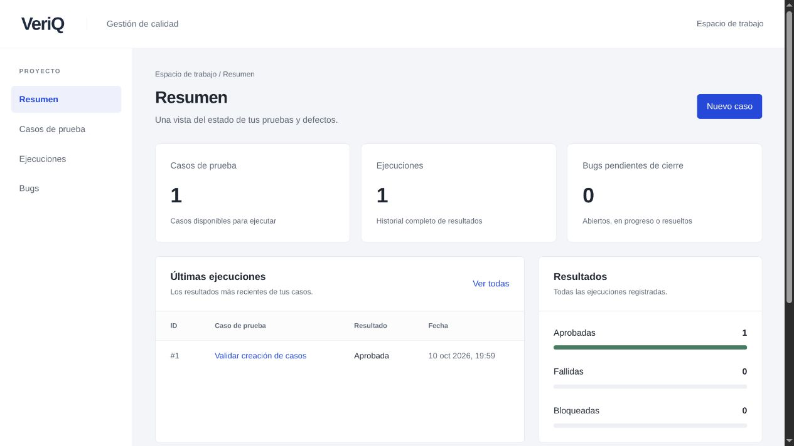

# VeriQ

**Gestión de casos de prueba, ejecuciones y defectos en una sola aplicación.**

VeriQ permite definir qué comprobar, registrar el resultado de cada ejecución y seguir los defectos hasta su cierre. Cada ejecución conserva una copia del caso probado: una edición posterior no altera la evidencia histórica.

[Abrir demo](https://veriq.roberto-antonio-lopez.workers.dev) · [Repositorio](https://github.com/RobertoAntonioLopez/veriq)

La demo utiliza una base independiente con datos de ejemplo. Es un espacio compartido sin inicio de sesión; los cambios son visibles para otros visitantes.

Proyecto de portafolio orientado a desarrollo backend y aseguramiento de calidad, construido con **Node.js, Express, PostgreSQL y JavaScript vanilla**.



*Captura del entorno de verificación con datos de prueba. Los conteos se calculan desde PostgreSQL.*

## Funcionalidades

| Módulo | Comportamiento |
| --- | --- |
| Casos de prueba | Crear, consultar, editar y eliminar casos sin historial; definir pasos, precondiciones, resultado esperado y prioridad. |
| Ejecuciones | Registrar Passed, Failed o Blocked, consultar el historial y filtrar por caso. |
| Bugs | Documentar reproducción, resultado esperado y actual; gestionar estado, severidad y prioridad de forma independiente. |
| Dashboard | Consultar seis métricas calculadas sobre los registros persistidos, incluyendo ceros cuando no hay datos. |

La interfaz incluye formularios con validación, tablas paginadas, estados vacíos y mensajes de error que conservan los datos introducidos. Se adapta a escritorio y móvil.

## Evidencia de calidad

La última ejecución registrada tiene **47 pruebas aprobadas, 0 fallidas y 0 omitidas**: 24 unitarias, 10 HTTP y 13 de integración con PostgreSQL real. [Consultar resultados y salida de la suite](docs/EXECUTION_RESULTS.md).

- **Integridad del historial:** PostgreSQL impide eliminar casos con ejecuciones; la API responde `409`.
- **Pruebas aisladas:** cada prueba de BD crea y elimina su propio esquema en una base exclusiva de pruebas.
- **Validación y persistencia:** cobertura de entradas inválidas, límites de texto, IDs inexistentes, edición parcial y consultas parametrizadas.
- **Defecto documentado:** [VQ-001](docs/BUG_REPORTS.md) muestra el diagnóstico y la corrección de un error detectado mediante integración real.

Los resultados corresponden a la versión y al entorno indicados en el informe; no representan una medición de cobertura de líneas. La colección de Postman está disponible y su ejecución aún no está registrada.

## Arquitectura

La API organiza el código por funcionalidad y separa las responsabilidades:

```text
Navegador → Router / controlador → Servicio → Repositorio → PostgreSQL
```

Los controladores traducen HTTP, los servicios aplican reglas de negocio y los repositorios ejecutan SQL parametrizado mediante `pg`. La aplicación Express se construye sin iniciar el servidor, lo que permite probarla con dependencias controladas. El dashboard utiliza un repositorio de lectura sin añadir un servicio que solo reenvíe llamadas.

[Decisiones de arquitectura y modelo de datos](docs/ARCHITECTURE.md) · [Referencia de la API](docs/API.md)

## Ejecutar localmente

Requisitos: **Node.js 24 o superior**, npm y PostgreSQL activo. La verificación registrada utilizó Node.js 26.8.1 y PostgreSQL 18.6. Se necesitan las utilidades `createdb` y `psql`, y un rol PostgreSQL con permiso para crear las bases.

Desde la carpeta del proyecto:

```sh
npm ci
cp .env.example .env
```

Configura `DATABASE_URL` y `TEST_DATABASE_URL` en `.env`. La base de desarrollo será `veriq` y la de pruebas `veriq_test`. Los siguientes ejemplos usan el rol local `veriq`; adapta host, puerto y usuario para que coincidan con tus URLs:

```sh
createdb -h 127.0.0.1 -U veriq veriq
createdb -h 127.0.0.1 -U veriq veriq_test
psql -h 127.0.0.1 -U veriq -d veriq -v ON_ERROR_STOP=1 -f database/schema.sql
npm start
```

Abre [VeriQ en localhost](http://127.0.0.1:3000). Este enlace funciona con el servidor local en ejecución; no es una demo alojada. No se necesita compilación del frontend. [Configuración detallada y solución de problemas](docs/SETUP.md).

## Despliegue

La aplicación incluye una entrada para Cloudflare Workers y mantiene PostgreSQL como almacenamiento. Consulta la [guía de despliegue](docs/DEPLOYMENT.md) para configurar la conexión como secreto y verificar la demo.

## Verificar el proyecto

```sh
# Unitarias y HTTP; PostgreSQL se omite si TEST_DATABASE_URL no está exportada.
npm test

# Suite completa, leyendo las dos URLs desde .env.
node --env-file=.env --test --test-reporter=spec

# Solo integración PostgreSQL y revisión de sintaxis.
npm run test:db
npm run check
```

La base de pruebas debe terminar en `_test` y tener un nombre distinto del de desarrollo. El usuario de pruebas necesita permiso `CREATE` en esa base. Una ejecución con pruebas omitidas no equivale a una verificación completa.

## Documentación

| Documento | Contenido |
| --- | --- |
| [Arquitectura](docs/ARCHITECTURE.md) | Responsabilidades, decisiones y relaciones entre datos. |
| [API REST](docs/API.md) | Endpoints, payloads, validaciones y códigos de respuesta. |
| [Plan de pruebas](docs/TEST_PLAN.md) | Riesgos, niveles de prueba y criterios de aceptación. |
| [Matriz de pruebas](docs/TEST_CASES.md) | Trazabilidad entre comportamientos y verificaciones. |
| [Resultados](docs/EXECUTION_RESULTS.md) | Entorno, comandos, evidencia y límites de la verificación. |
| [Reporte de defecto](docs/BUG_REPORTS.md) | Reproducción, causa raíz y regresión de VQ-001. |
| [Colección Postman](postman/README.md) | Solicitudes importables para el CRUD de casos. |

## Alcance y mejoras siguientes

El MVP está pensado para un único espacio de trabajo. No incluye autenticación, roles, adjuntos ni exportaciones. El despliegue de demostración en Cloudflare Workers requiere una base PostgreSQL alojada y exclusiva con datos ficticios. La inmutabilidad del historial se garantiza a través de la API; un administrador con acceso SQL puede modificar los registros.

Las siguientes mejoras serían migraciones versionadas, autenticación para uso compartido, control de conflictos de edición y una suite de navegador repetible. La revisión visual actual no sustituye una auditoría completa de accesibilidad.
